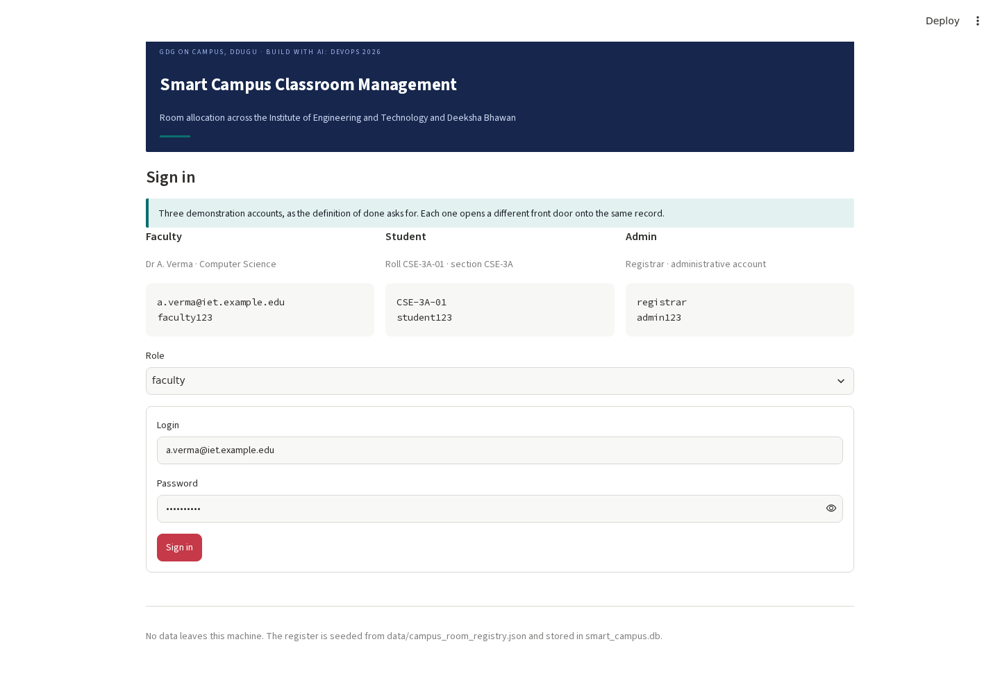

# Smart Campus Classroom Management

**Build With AI: DevOps 2026 · GDG on Campus, Deen Dayal Upadhyaya Gorakhpur University**

A working prototype of the corrected design: room allocation across the Institute of Engineering
and Technology and Deeksha Bhawan, where a room is a **timeline** rather than a switch, conflicts
are refused by the **storage engine** rather than by application code, and nothing is ever deleted.



---

## The problem in one paragraph

Thirty-two sections of about seventy-five students share thirty bookable rooms across eight
teaching periods. Last year a group of students missed a minor examination because a room was
needed somewhere else at the same hour and nobody could see, in one place, which rooms were
promised to whom. The information failure was the symptom; the allocation failure came first. This
prototype is the allocation fix: derived availability over three occupancy sources, three exclusion
constraints in the database, a policy layer with one decision function, and an audit trail that can
replay any room's state.

## Run it

```bash
pip install -r requirements.txt
streamlit run app.py
```

The register, the academic structure and a few demonstration bookings are seeded on first run from
`data/campus_room_registry.json`. Three demonstration accounts are printed on the sign-in page:

| Role | Login | Password |
|---|---|---|
| Faculty | `a.verma@iet.example.edu` | `faculty123` |
| Student | `CSE-3A-01` | `student123` |
| Administrator | `registrar` | `admin123` |

The administrator's sidebar carries **Reset demonstration data**, which returns the campus to its
seeded state.

## What is implemented

| Area | What it does |
|---|---|
| **Derived availability** | Free rooms computed from live reservations ∪ timetable ∪ closures. No row stores a free flag. |
| **Three exclusion constraints** | Room, section and faculty cannot each be in two places at once — enforced by database triggers, so the engine arbitrates, not the application. |
| **Booking lifecycle** | Create, approve, reject, reschedule, early release, displace, complete. Cancellation is a status with a reason; nothing is deleted. |
| **Ranked alternatives** | A refusal carries three substitutes with scores, and the score is decomposed into reasons a person can read. |
| **Examination scarcity** | Spaced capacity is separate from nominal capacity, and a request no single room can hold produces a split sitting rather than an empty list. |
| **Weekly series** | Eight weeks of a class created and cancelled as one action. |
| **Roles and the matrix** | One `can()` function; every route asks it first, and the negative cells are tested as hard as the positive ones. |
| **Structured reports** | Students report a wrong room as a category, not a paragraph. Duplicates merge into one item with a count. |
| **Notices and outbox** | A change writes notification rows inside the same transaction, so a mail failure cannot undo a booking. |
| **Policy settings** | Six values that decide behaviour, each with a history and an audit row. |
| **Audit trail** | Every state change is recorded with before and after, and a room's past state can be replayed from events alone. |
| **Grounded assistant** | Parses a question, runs a real query, and replaces any answer that names a room the query did not return. It has no write path at all. |
| **Concurrency drill** | Twenty threads, one room, one window: one success and nineteen refusals, each with alternatives. |

## The screen set

- **Student** — My schedule · Room availability · Notices · Report a problem · Ask the assistant
- **Faculty** — My reservations · Find a room · Weekly series · Notices · Ask the assistant
- **Administrator** — At a glance · Approval queue · Room register · Closures · Reports · Policy
  settings · Audit trail · Announcements · Concurrency drill · Ask the assistant

## Testing

| Suite | Result |
|---|---|
| Domain (pytest) | **150 cases, all passing** |
| Browser (Playwright, real Chromium) | **38 scenarios, all passing**, 40 screenshots |
| Defects found and fixed during the work | **13**, plus one recorded limitation |

The full report — with the screenshots, the findings, the root causes, the fixes and the
traceability back to every section of the design — is
**[docs/testing/TESTING_REPORT.md](docs/testing/TESTING_REPORT.md)**
(Word version: `docs/testing/TESTING_REPORT.docx`).

```bash
python3 -m pytest tests -q                 # 150 domain cases
python3 tests/e2e/run_browser_suite.py     # 38 browser scenarios on a fresh database
```

Two failures worth reading about in the report: the sign-in screen crashed before it rendered a
form while 149 domain tests were passing, and the audit replay reported every room free at the
exact instant it was booked because an instant has zero width and half-open intervals cannot
overlap one.

## Layout

```
app.py                  sign-in, shell and navigation
core/
  intervals.py          half-open interval arithmetic; pure, no framework
  policy.py             one can() function, the permission matrix, settings
  availability.py       derived availability over three occupancy sources
  booking.py            the lifecycle and its transactions
  scoring.py            ranked alternatives and split sittings
  records.py            closures, notices, reports, room correction
  audit.py              the trail, the diff and the replay
  assistant.py          grounded search and its guardrail
  analytics.py          the arithmetic of scarcity, computed live
  drill.py              the concurrency drill
  schema.sql            seventeen entities and the three exclusion triggers
  seed.py               register, sections, timetable, demonstration data
data/campus_room_registry.json   the room register, versioned
ui/                     Streamlit screens and the shared components
tests/                  150 domain cases
tests/e2e/              the browser harness and 38 scenarios
qa/                     result files and the report builders
docs/testing/           the testing report and its screenshots
```

## Honest boundaries

SQLite stands in for PostgreSQL (the exclusion constraints are database triggers, so the
engine still arbitrates), the assistant is rule-based rather than a hosted model, notifications
are an outbox rather than email, and the three accounts share fixed demonstration passwords. Each
boundary and its justification is set out in section 7 of the testing report.

## Licence

MIT — see [LICENSE](LICENSE).
