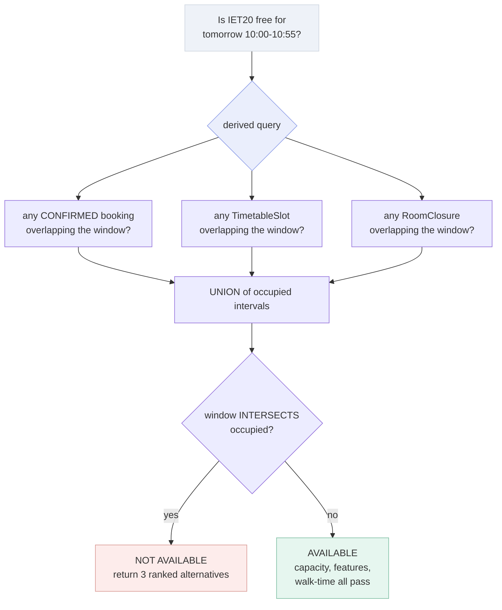
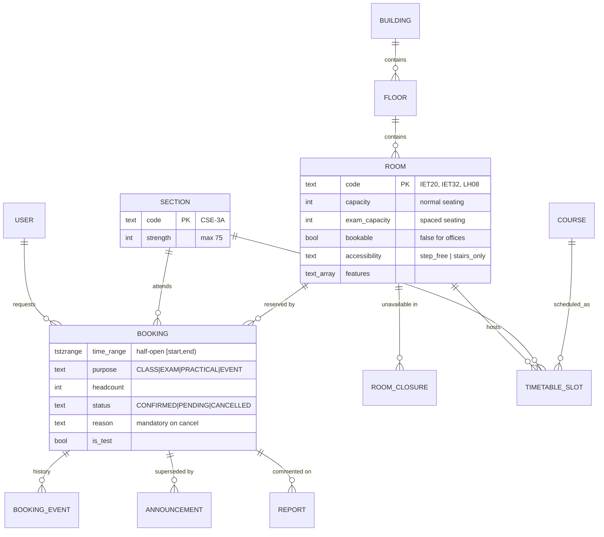
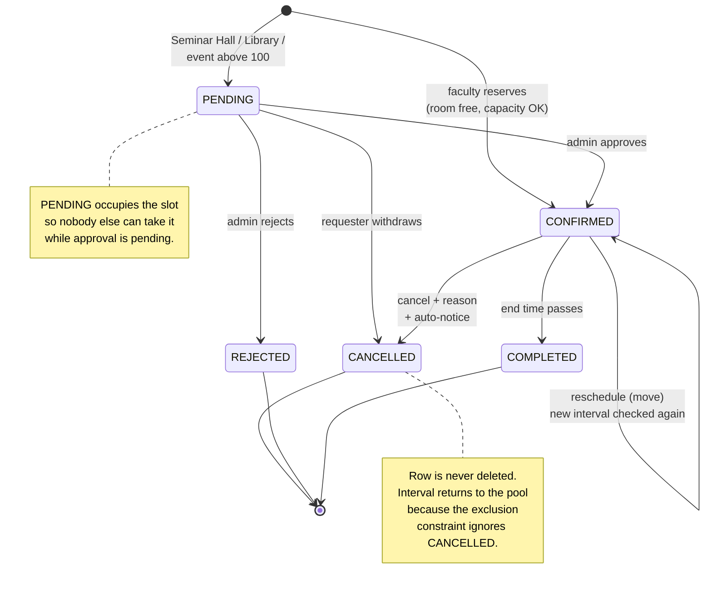
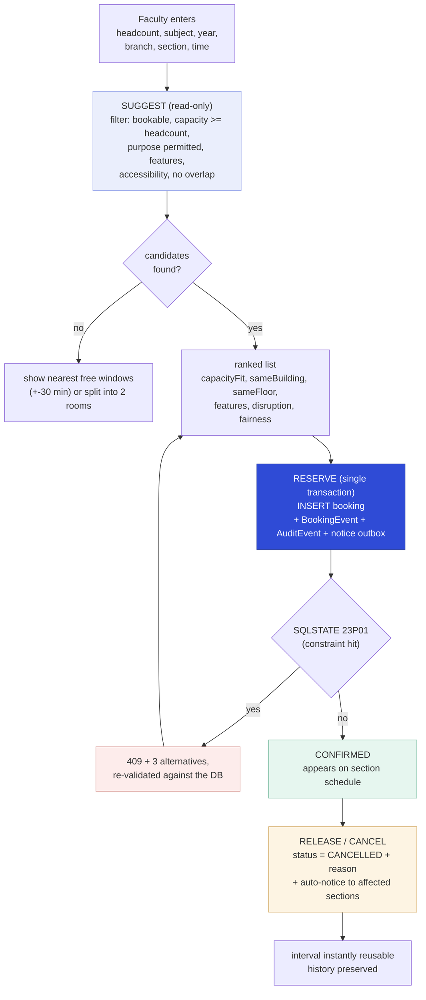
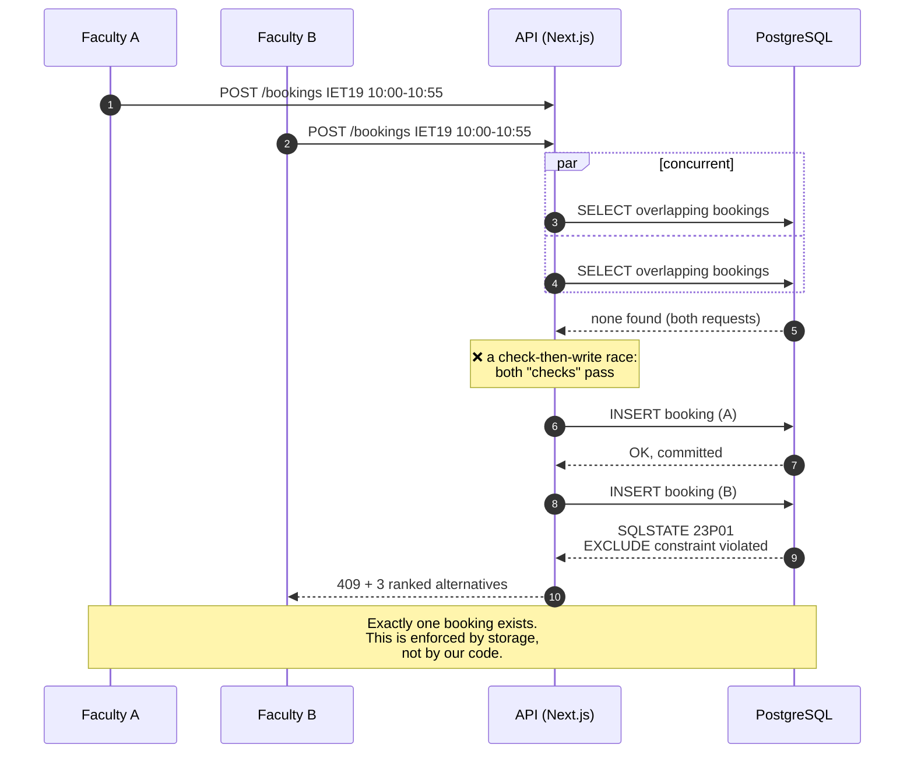
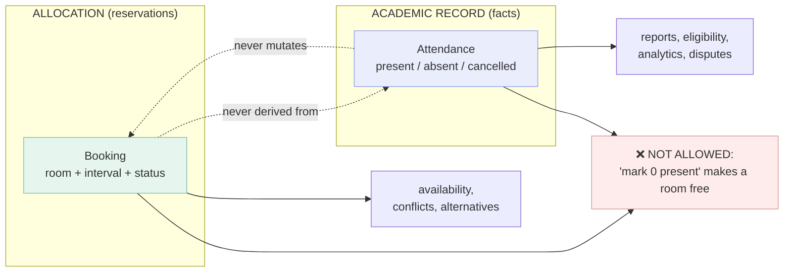
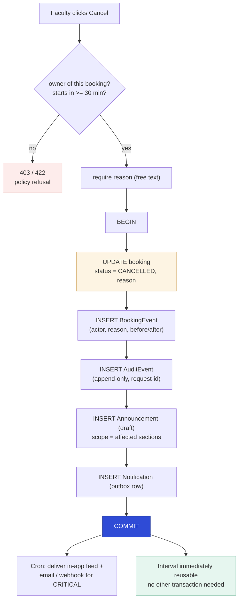

# Occupancy model — corrected design in diagrams

Mermaid sources for the room-allocation model. Paste any block into <https://mermaid.live>, GitHub, Obsidian or VS Code (Markdown Preview Mermaid Support) to render.

---

## 1 · Why a "free / occupied" toggle fails, and what replaces it

A room is not a switch. It is a **timeline of reservations**. Availability is *derived* at query time, never stored.

```mermaid
gantt
    title IET first floor + Deeksha — Wed 09:00–12:40  (derived from bookings, never stored)
    dateFormat HH:mm
    axisFormat %H:%M
    todayMarker off

    section IET20
    CSE-2A DBMS (confirmed)        :done,  a1, 09:00, 55m
    CANCELLED - freed by release   :crit,  a2, 09:55, 55m
    CSE-3A practical (confirmed)   :done,  a3, 10:50, 55m
    free                           :a4, 11:45, 55m

    section IET19
    AIML-2B Maths (confirmed)      :done,  b1, 09:00, 55m
    free                           :b2, 09:55, 165m

    section LH08
    free all morning               :c1, 09:00, 220m
```



Read the `crit` block: the class was **cancelled**, the booking row still exists with `status = CANCELLED`, and only the remainder returned to the pool. Nothing was deleted, so the audit trail survives — and the freed interval is free *because the exclusion constraint only covers `CONFIRMED` / `PENDING`*.



---

## 2 · The three constraints that make the system correct

One booking can violate three different kinds of "double booking". A room-only check catches the first and silently permits the other two.





The DB-level rules:

```sql
-- 1. no room is double-booked
EXCLUDE USING gist (room_id WITH =, time_range WITH &&)
  WHERE (status IN ('CONFIRMED','PENDING'));

-- 2. no SECTION is in two rooms at once   <-- the one teams forget
EXCLUDE USING gist (section_id WITH =, time_range WITH &&)
  WHERE (status IN ('CONFIRMED','PENDING'));

-- 3. no FACULTY is in two rooms at once
EXCLUDE USING gist (requested_by WITH =, time_range WITH &&)
  WHERE (status IN ('CONFIRMED','PENDING'));
```

---

## 3 · The three operations, and nothing else

Suggestion is a **read**. Only reservation is a **write**. That separation is why a stale suggestion can never corrupt the schedule.



---

## 4 · Why the race condition is not a code problem

Two faculty, same room, same slot, same second. Application-level checks let both through. The database does not.



---

## 5 · Attendance is NOT an allocation signal

The single most important separation in the model.



Why the red path is banned:

- **A class that started at 10:00 is still running at 10:20.** Releasing it mid-period hands a room to another class while 60 students and their bags are still in it. Zero practical value.
- **"0 present" and "cancelled" are different facts.** Conflating them destroys the distinction that caused the original NSS incident.
- **It creates a perverse incentive:** mark students absent → get a better room slot.
- **Real reuse is planned, not accidental.** "Tomorrow's P3 is cancelled" → notice → slot re-bookable. That is where the benefit actually lives.

---

## 6 · What a good cancellation payload looks like



Everything that matters happens in **one transaction**: the status change, the history, the audit, and the notice. A cancellation therefore cannot be silent — which is the failure the original problem statement was written about.

---

## Summary

| Concept | Wrong | Right |
|---|---|---|
| Room state | `status: FREE / OCCUPIED` | intervals in `Booking`, availability derived |
| Freeing a room | delete / clear the record | `status = CANCELLED` + reason, row kept |
| Trigger for freeing | "0 present" attendance | explicit release or cancellation |
| Conflict check | `if (room.isFree)` in app code | `EXCLUDE USING gist` in PostgreSQL |
| What is checked | room only | room **+ section + faculty** |
| Capacity | one number | `capacity` + `exam_capacity` (spaced seating) |
| Suggestion | the answer | a read-only hint; the DB decides at insert |
| Attendance | allocation signal | separate academic record, never mutates allocation |
