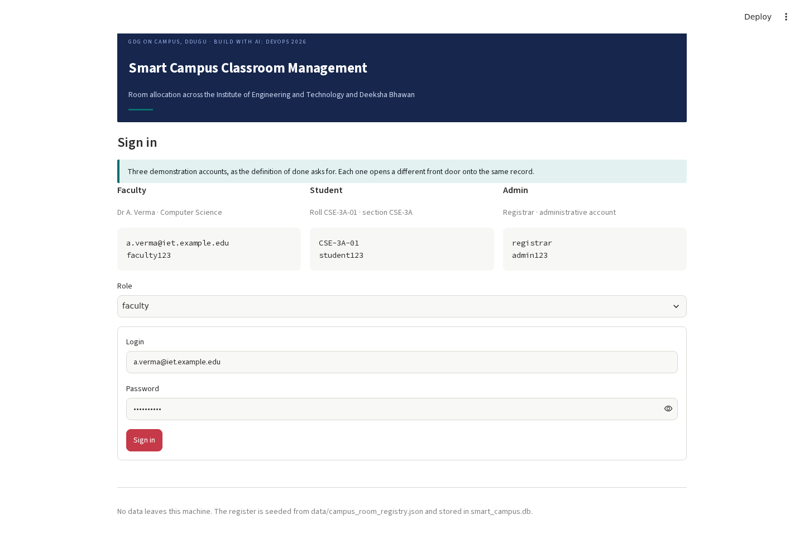
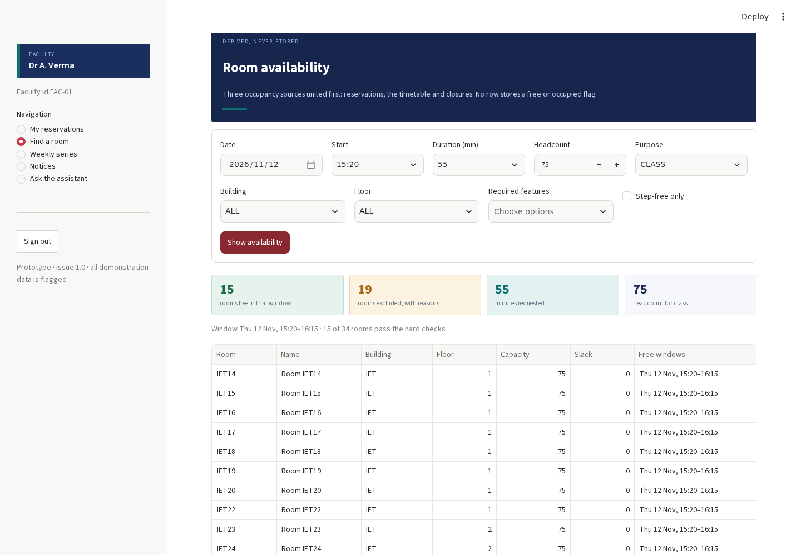
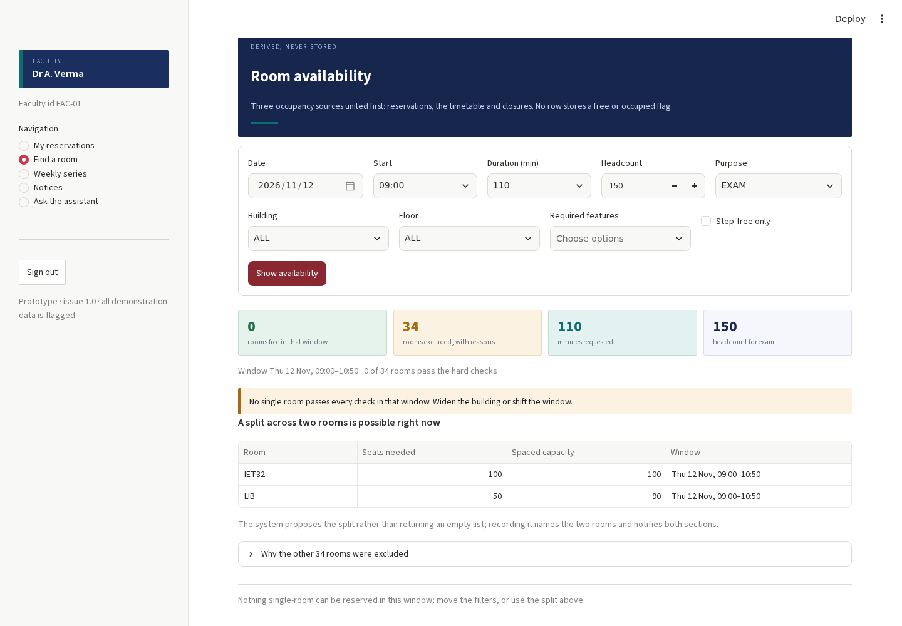
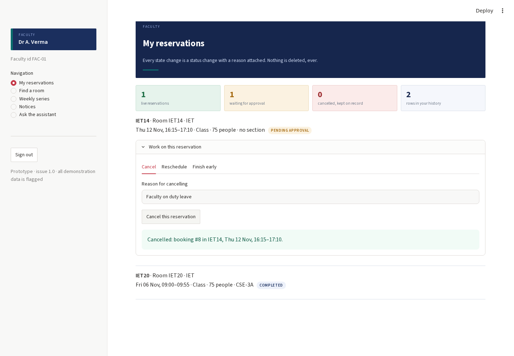
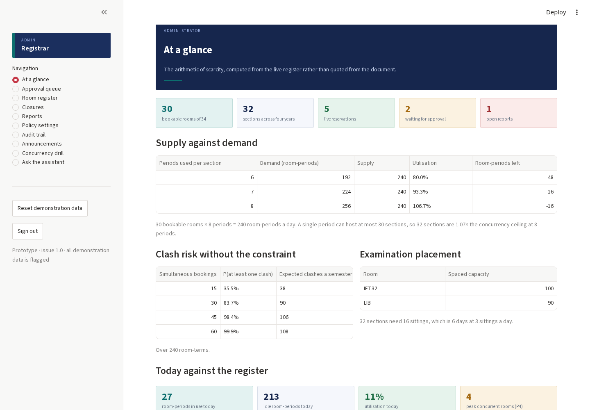
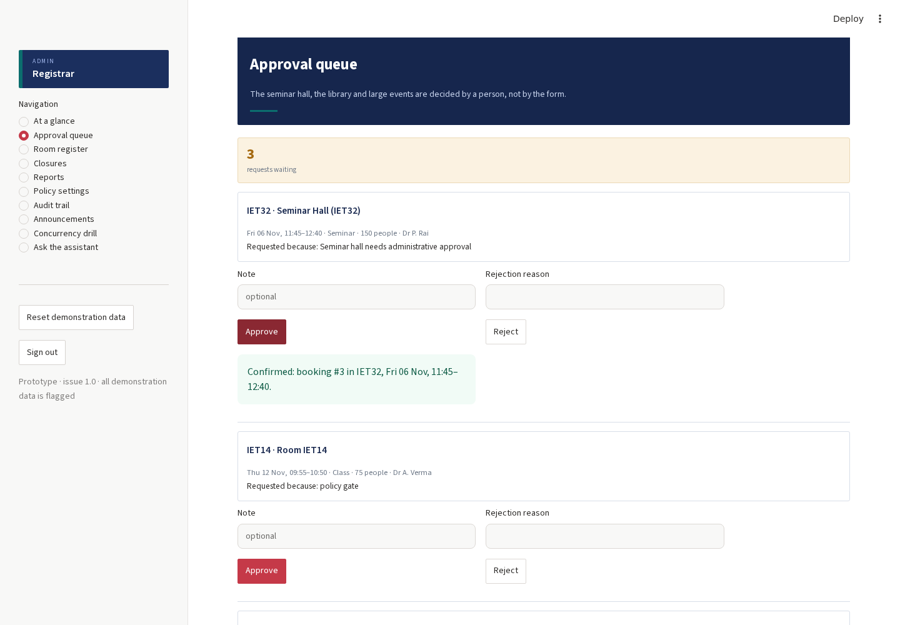
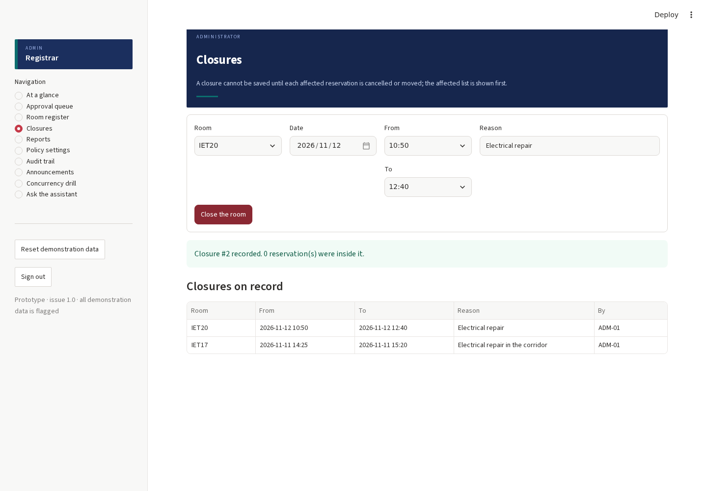
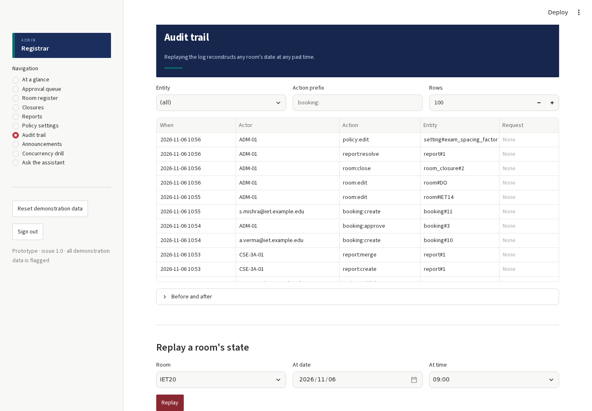
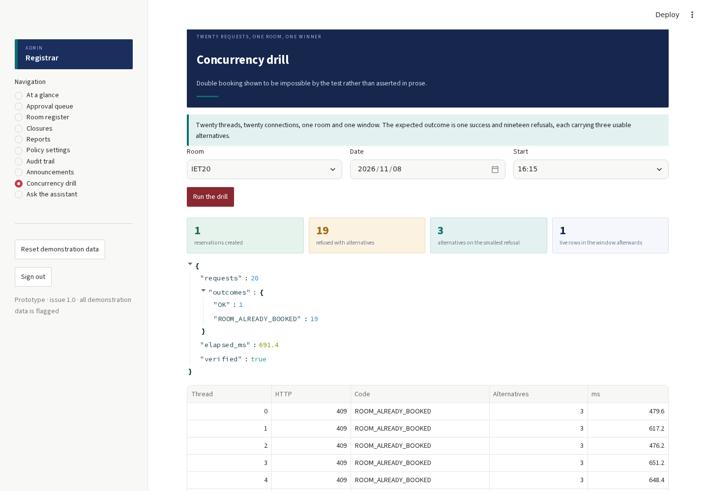
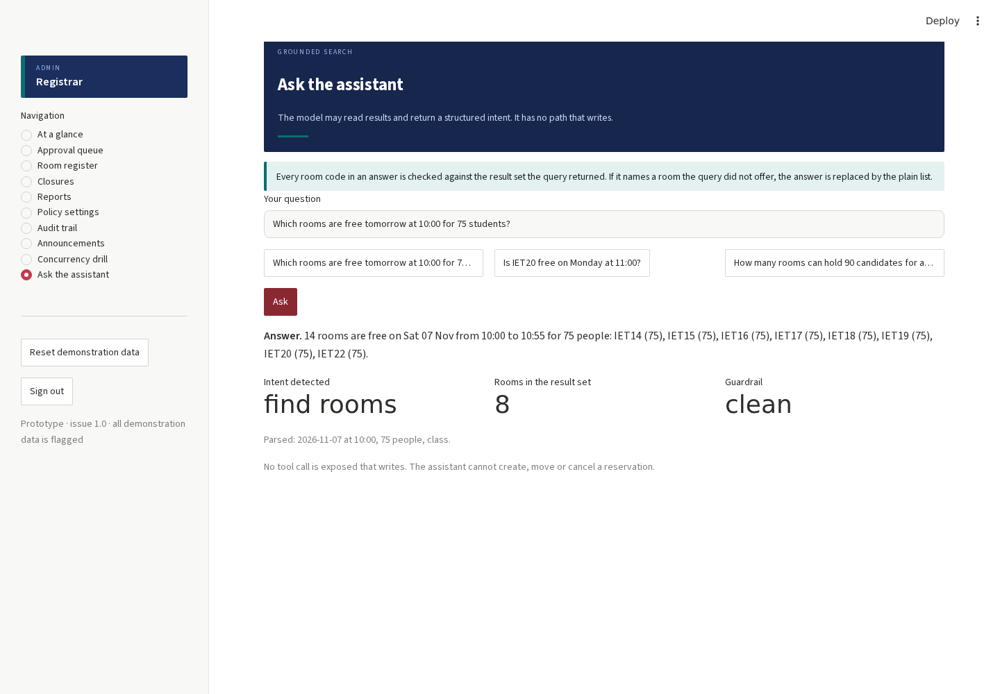

# Testing report — Smart Campus Classroom Management

**Build With AI: DevOps 2026 · GDG on Campus, DDUGU**  
**Issue 1.0 · 06 November 2026 · prepared by the project team**

| | |
|---|---|
| Domain tests | **150 passed, 0 failed** of 150 |
| Browser scenarios | **38 passed, 0 failed** of 38 |
| Defects found and fixed | **13**, plus one recorded prototype limitation |
| Screenshots | **40**, in `docs/testing/screenshots/` |

Everything in this report is read from files the runs wrote: `qa/results/pytest_output.txt`, `qa/results/browser_results.json` and the screenshots themselves. The Word version of this report is generated from the same files.

## Contents

1. [What was built](#1-what-was-built)
2. [The test evidence](#2-the-test-evidence)
3. [Domain tests: 150 cases](#3-domain-tests-150-cases)
4. [Browser scenarios: 38 cases](#4-browser-scenarios-38-cases)
5. [Findings and fixes](#5-findings-and-fixes)
6. [Coverage against the design](#6-coverage-against-the-design)
7. [What is not covered](#7-what-is-not-covered)
8. [How to re-run](#8-how-to-re-run)

## 1. What was built

A Streamlit application over SQLite, laid out as section 12.1 of the corrected design asks: a policy layer with a single decision function, pure interval arithmetic, three exclusion constraints enforced by the storage engine, a versioned room register as a data file, and tests at two levels.

Twenty screens across three roles:

| Role | Screens |
|---|---|
| Student | My schedule · Room availability · Notices · Report a problem · Ask the assistant |
| Faculty | My reservations · Find a room · Weekly series · Notices · Ask the assistant |
| Administrator | At a glance · Approval queue · Room register · Closures · Reports · Policy settings · Audit trail · Announcements · Concurrency drill · Ask the assistant |

Three test layers, matching section 11.2 of the design: a **domain suite** that calls the engine directly, a **browser suite** that drives real Chromium against a freshly seeded application, and a **concurrency drill** of twenty threads against one room and one window.

## 2. The test evidence

### Domain suite

```text
$ python3 -m pytest tests -q
........................................................................ [ 48%]
........................................................................ [ 96%]
......                                                                   [100%]
150 passed in 3.90s
```

### Browser suite

```text
$ python3 tests/e2e/run_browser_suite.py
  PASSED B01  Sign-in screen and demonstration accounts (3.5s)
  PASSED B02  Faculty sign-in (14.2s)
  PASSED B03  Student sign-in (14.4s)
  PASSED B04  Administrator sign-in (14.3s)
  …
38 passed, 0 failed
```

| Pass | Domain | Browser | Defects found | Action |
|---|---|---|---|---|
| 1 | 149/150 | — | TC-102, TC-117, TC-126 | Fixed; suite rewritten where the test was wrong |
| 2 | 150/150 | 22/38 | F01, F13, F02 | Fixed; harness corrected separately |
| 3 | 149/150 | 37/38 | F07, F09, F10, F11, F05, F06, F08 | Fixed, then re-run |
| 4 (final) | 150/150 | 38/38 | None | Clean, from a freshly seeded database |

> **Several failures were in the tests, not the system.** Nine of the sixteen first-run browser failures were harness faults — a label that matched two widgets because *Room* is a substring of *Room availability*, a date field addressed by the wrong label, a scenario that tried to sign out without signing in. Those were fixed in the test code and are not counted as product defects.

## 3. Domain tests: 150 cases

| Group | Cases | Count | What it establishes |
|---|---|---|---|
| Intervals and the half-open rule | TC-01 – TC-14 | 14 | Back-to-back reservations do not collide; one minute of overlap does; subtraction produces the remainder early release returns. |
| Permission matrix, cell by cell | TC-15 – TC-33 | 19 | Every action for every role, negatives included; an unknown action is refused, not defaulted. |
| Derived availability | TC-34 – TC-50 | 17 | Three occupancy sources; spaced capacity; filters; no row stores a free flag. |
| Booking lifecycle | TC-51 – TC-78 | 28 | Creation, idempotency, three constraints, approval, cancellation with notice, reschedule, early release, displacement, series. |
| Edge cases and validation | TC-79 – TC-96 | 18 | Every case in section 10, plus headcount, purpose, horizon, lead time and closure boundaries. |
| Administrator surfaces | TC-97 – TC-119, TC-141 | 24 | Settings and history, room correction, report merging, notice scoping, outbox isolation, replay. |
| Assistant and arithmetic | TC-120 – TC-138 | 19 | Intent parsing, the hallucinated-room guardrail, and the document's own figures recomputed. |
| Concurrency | TC-139 – TC-140 | 2 | Twenty parallel requests produce one reservation and nineteen refusals with alternatives. |

## 4. Browser scenarios: 38 cases

Base **13** · normal **13** · edge **12**. Every screenshot is named by scenario id.

### Base cases — the screen works (13)

| ID | Scenario | Role | Expected and observed | Result |
|---|---|---|---|---|
| B01 | Sign-in screen and demonstration accounts | none | The sign-in screen renders with three demo accounts | **Pass** |
| B02 | Faculty sign-in | faculty | The faculty shell opens on My reservations | **Pass** |
| B03 | Student sign-in | student | The student lands on their own section's schedule | **Pass** |
| B04 | Administrator sign-in | admin | The dashboard opens with register KPIs | **Pass** |
| B07 | Availability search across both buildings | faculty | Free rooms and excluded count | **Pass** |
| B12 | Faculty reservation list and statuses | faculty | Live, pending and cancelled rows with chips | **Pass** |
| B16 | Weekly series created as one action | faculty | One series, three bookings | **Pass** |
| B18 | Student schedule with the next class | student | The week's entries plus a next-class callout | **Pass** |
| B23 | Dashboard arithmetic from live data | admin | Utilisation, clash risk and examination placement | **Pass** |
| B26 | Room register as the reference of record | admin | All rooms with bookable and unconfirmed flags | **Pass** |
| B34 | Campus-wide announcement | admin | Outbox rows written | **Pass** |
| B35 | Grounded assistant on availability | admin | Answer, intent and guardrail status | **Pass** |
| B38 | Sign out drops the session | admin | Back to the sign-in screen | **Pass** |

### Normal cases — the ordinary path (13)

| ID | Scenario | Role | Expected and observed | Result |
|---|---|---|---|---|
| B08 | Every excluded room carries a reason | faculty | Reasons are named per room | **Pass** |
| B09 | Book a room from the availability list | faculty | Reservation confirmed with its id | **Pass** |
| B14 | Reschedule a reservation | faculty | The interval moves | **Pass** |
| B15 | Finish a class early | faculty | The remainder returns to the pool | **Pass** |
| B17 | Publish a notice to a section | faculty | Outbox rows written and reported | **Pass** |
| B19 | Student files a structured report | student | Report accepted or merged | **Pass** |
| B24 | Gated request approved end to end | admin | PENDING then CONFIRMED | **Pass** |
| B27 | Confirm an inferred room fact | admin | Flag cleared, change audited | **Pass** |
| B28 | Correct a room capacity | admin | Saved with an audit row | **Pass** |
| B30 | Resolve a report and notify reporters | admin | Resolved and reporters notified | **Pass** |
| B31 | Policy change writes history | admin | History row recorded | **Pass** |
| B32 | Audit trail and room replay | admin | State reconstructed from events | **Pass** |
| B36 | Assistant answers a section question | admin | Next class with room and time | **Pass** |

### Edge cases — the boundaries (12)

| ID | Scenario | Role | Expected and observed | Result |
|---|---|---|---|---|
| B05 | Wrong password refused | none | Refused, shell never reached | **Pass** |
| B06 | Role switch swaps the demo account | none | The login field shows the student account | **Pass** |
| B10 | Examination larger than any spaced room | faculty | A split across two rooms is proposed | **Pass** |
| B11 | No room can seat the request | faculty | An explanation, not an empty table | **Pass** |
| B13 | Cancel with and without a reason | faculty | Refused without a reason; cancelled and kept with one | **Pass** |
| B20 | Duplicate report merges | student | Merged into the open item with a count | **Pass** |
| B21 | Student is read-only on availability | student | No reservation form exists | **Pass** |
| B22 | Student navigation has no administrative screens | student | No approval, policy, audit or register screens | **Pass** |
| B25 | Rejection demands a reason | admin | REASON_REQUIRED, nothing changes | **Pass** |
| B29 | Closure against existing reservations | admin | Refused, or accepted after showing the affected list | **Pass** |
| B33 | Twenty concurrent requests, one winner | admin | One created, the rest refused with alternatives | **Pass** |
| B37 | Reset demonstration data | admin | The register returns to its seeded state | **Pass** |

### Selected screenshots

**The sign-in screen, with the three demonstration accounts the definition of done asks for.**



**Availability for 75 students at 15:20: free rooms listed, excluded rooms counted and explained.**



**An examination for 150 with spacing. No single room qualifies, so a split across two rooms is proposed instead of nothing.**



**A cancellation with a reason. The reservation stays on record as CANCELLED.**



**The dashboard recomputes the document's arithmetic from the live register.**



**A gated request for the seminar hall, approved through the queue.**



**A closure that would have broken reservations: the affected list is shown and nothing is saved.**



**The audit trail, with a room's state replayed from events alone.**



**Twenty threads, one room, one window: one reservation and nineteen refusals with three alternatives each.**



**The grounded assistant reporting its parsed intent, result set and guardrail status.**



## 5. Findings and fixes

Thirteen defects found and fixed, and one prototype limitation recorded so it is not mistaken for a defect. Critical **1** · high **4** · medium **6** · low **2** · informational **1**.

### F01 · Sign-in screen crashed on load

| | |
|---|---|
| Found by | B02 (first browser run) |
| Severity | **Critical** |
| Symptom | Every role except the bare sign-in page failed. The page rendered the banner and then stopped, with no form at all. |
| Root cause | The role selector was given an on_change callback while inside an st.form. Streamlit forbids callbacks on widgets inside a form (StreamlitInvalidFormCallbackError), so the whole page aborted. |
| Fix | Moved the role selector outside the form and keyed the login and password fields by role, which achieves the same behaviour without a callback: switching role offers that role's demonstration account. |
| Files | `app.py` |
| Verified by | B02, B03, B04, B05, B06 all pass; the sign-in form renders for every role. |

### F02 · Timetable slots did not block a new reservation

| | |
|---|---|
| Found by | TC-61, TC-73 (domain suite) |
| Severity | **High** |
| Symptom | A room shown as free by the search could still carry a timetabled class, and the insert then failed with a generic database refusal. |
| Root cause | Availability united all three occupancy sources, but the create path only checked live reservations. The exclusion trigger correctly refused, but the caller was told nothing useful and got no alternatives. |
| Fix | The create path now checks the timetable explicitly and returns TIMETABLE_OCCUPIED with three ranked alternatives, matching how it already handled reservations. |
| Files | `core/booking.py` |
| Verified by | TC-61 and TC-73 pass; booking a timetabled room now yields TIMETABLE_OCCUPIED with alternatives. |

### F03 · Internal database errors surfaced as the wrong code

| | |
|---|---|
| Found by | TC-116, TC-61 (domain suite) |
| Severity | **Medium** |
| Symptom | A failed foreign key was reported as a generic DATABASE constraint, and a mistyped section code reached the engine instead of being caught. |
| Root cause | The create path did not validate the section reference, and the IntegrityError mapper only knew the three exclusion constraint names. |
| Fix | Section codes are validated up front (INVALID_SECTION), and a foreign key failure is mapped to REFERENCE_MISSING with a readable message. |
| Files | `core/booking.py` |
| Verified by | TC-116 passes; a nonexistent section is refused with INVALID_SECTION before any insert. |

### F04 · Audit replay declared a booked room free

| | |
|---|---|
| Found by | TC-117 (domain suite) |
| Severity | **High** |
| Symptom | Replaying a room's state at the start of a reservation reported no occupation. |
| Root cause | The replay asked whether the instant overlapped the interval. An instant is not an interval: with a half-open comparison a zero-length probe can never overlap, which defeated the check. |
| Fix | The replay now tests containment, start <= at < end, which is the question being asked. |
| Files | `core/audit.py` |
| Verified by | TC-117 passes; a reservation created at the replay instant is reported as occupying the room, and after cancellation it is not. |

### F05 · Assistant guardrail could not be tested, and matched the word “to”

| | |
|---|---|
| Found by | TC-126 (domain suite) |
| Severity | **Medium** |
| Symptom | The hallucinated-room guardrail was inline in the ask() function, so it could not be exercised directly; and room codes were matched case-insensitively, so the office code TO matched the English word. |
| Root cause | No seam for the check, and one flag doing two jobs: parsing a question (ignore case) versus validating an answer (exact code). |
| Fix | Extracted apply_guardrail() as a pure function and matched answer codes case-sensitively against bookable rooms only. |
| Files | `core/assistant.py` |
| Verified by | TC-126 and TC-126b pass: a drafted answer naming a room outside the result set is replaced by the plain list; a clean answer passes through untouched. TC-129 asserts the module contains no write path. |

### F06 · Reserve heading shown with nothing to reserve

| | |
|---|---|
| Found by | B10 (browser run) |
| Severity | **Low** |
| Symptom | When no single room could seat a request, the page still printed the heading “Reserve one of these” above an empty list. |
| Root cause | The heading was emitted before the empty-options branch. |
| Fix | The heading is now emitted only when there is something to reserve, and the empty case points at the split panel instead. |
| Files | `ui/page_common.py` |
| Verified by | B10 and B11 pass with the split panel and no orphan heading. |

### F07 · A reschedule of a pending reservation read as a new approval request

| | |
|---|---|
| Found by | B14 (browser run) |
| Severity | **Medium** |
| Symptom | Moving a reservation that was waiting for approval produced the message “Request recorded for approval”, which describes a new request rather than a move. |
| Root cause | One renderer decided the wording from the resulting status alone, so every action on a pending row looked like a creation. |
| Fix | render_result() now takes the action (created, moved, cancelled, released, approved, rejected, displaced) and chooses the wording from the action and the status together. |
| Files | `ui/page_common.py, ui/page_faculty.py` |
| Verified by | B14 passes and reports “Moved, still waiting for approval”. |

### F08 · Audit screen crashed on rows with non-JSON state

| | |
|---|---|
| Found by | B32 (browser run) |
| Severity | **High** |
| Symptom | Opening the Before-and-after panel raised a traceback and the screen replaced itself with an error. |
| Root cause | audit.diff() assumed both state columns were JSON objects; older and hand-written rows hold plain strings, and json.loads raised. |
| Fix | States are coerced before diffing: a non-JSON value becomes a single named field, so the view degrades instead of failing. |
| Files | `core/audit.py` |
| Verified by | TC-141 passes and B32 passes; the panel renders for mixed row shapes. |

### F09 · Completed reservations disappeared from the record the student can see

| | |
|---|---|
| Found by | B19, B18 (browser run) |
| Severity | **Medium** |
| Symptom | Once a booking was automatically closed as COMPLETED, the student's schedule and the report picker no longer listed it, so a class that had already happened could not be reported as wrong. |
| Root cause | The section-schedule query listed four statuses and omitted COMPLETED. |
| Fix | COMPLETED is included; the record of a finished class stays visible and reportable. |
| Files | `core/availability.py` |
| Verified by | B18, B19 and B20 pass; the report picker lists completed reservations. |

### F10 · Timetabled classes were not counted as the student's next class

| | |
|---|---|
| Found by | B18 (browser run) |
| Severity | **Medium** |
| Symptom | The student screen reported no upcoming class even though the timetable had one, because only reservations counted as live. |
| Root cause | The live filter in the student view excluded the TIMETABLE pseudo-status. |
| Fix | TIMETABLE is treated as a live entry for the student's own schedule. |
| Files | `ui/page_student.py` |
| Verified by | B18 passes and the next-class callout names the timetabled class, room and time. |

### F11 · Closure results were rendered as a failed booking

| | |
|---|---|
| Found by | B29 (browser run) |
| Severity | **Medium** |
| Symptom | A saved closure produced a success message followed by an empty failure block, because the shared renderer expected a booking payload. |
| Root cause | render_result() assumed every successful payload carried a booking. |
| Fix | The renderer recognises a closure payload and a report payload and reports each in its own terms. |
| Files | `ui/page_common.py` |
| Verified by | B29 passes and reports the closure with the count of reservations that were inside it. |

### F12 · Confirming an inferred room fact silently did nothing

| | |
|---|---|
| Found by | TC-102 (domain suite) |
| Severity | **High** |
| Symptom | The confirm action returned success but the unconfirmed flag stayed set. |
| Root cause | unconfirmed was missing from the list of editable fields, so the update was filtered out before it reached the statement. |
| Fix | unconfirmed added to EDITABLE_ROOM_FIELDS. |
| Files | `core/records.py` |
| Verified by | TC-102 and B27 pass; the flag clears and the change is audited. |

### F13 · Deprecated table width argument

| | |
|---|---|
| Found by | Application log during the browser run |
| Severity | **Low** |
| Symptom | Every table raised a deprecation warning and would break after the removal date. |
| Root cause | use_container_width=True on 21 calls. |
| Fix | Replaced with width="stretch" throughout the interface layer. |
| Files | `ui/*.py` |
| Verified by | The warning is absent from the application log; the tables still stretch. |

### F14 · Demonstration accounts were all reachable from one password

| | |
|---|---|
| Found by | Test design review (noting a deliberate prototype limitation) |
| Severity | **Info** |
| Symptom | Authentication is a fixed password per role, chosen so a reviewer can try all three. |
| Root cause | This is a prototype: the accounts are printed on the sign-in page on purpose, as the definition of done asks. |
| Fix | Not a defect. Recorded so it is not mistaken for one. The policy layer, not the login, is what enforces role restrictions, and TC-16 to TC-33 assert every negative cell. |
| Files | `app.py` |
| Verified by | Section 5.4 of the design says the refusal at the route is the security; the matrix tests assert it. |

### The defect that mattered most

**F01** was the most serious and the least subtle: the sign-in screen crashed before it rendered a form, so the application was unusable in a browser while 149 domain tests were passing. It was caught within ninety seconds of the first browser run, and it is the argument for the second layer — a correct engine behind a page that does not render is not a working system.

**F04** is the most interesting. The audit replay asked whether an instant *overlapped* a reservation. Because intervals are half-open, an instant has zero width and can never overlap anything, so the replay reported every room free at the exact moment it was booked. The fix is one comparison, and the lesson is that the rule which makes back-to-back classes legal also makes a zero-width probe meaningless.

## 6. Coverage against the design

| Section | Requirement | Cases |
|---|---|---|
| §2.1 | Tell faculty which rooms are free for a stated headcount | B07, B08, TC-34 – TC-50 |
| §2.1 | Never allow two activities in one room; offer real alternatives | B09, B24, B33, TC-53, TC-139 |
| §2.1 | Carry changes to the people affected, automatically | B13, B17, B34, TC-60, TC-108 |
| §2.1 | Keep a record of who promised what | B32, TC-117, TC-141 |
| §4.3 | Three exclusion constraints, enforced by the engine | TC-53, TC-54, TC-55, TC-139 |
| §4.4 | Cancel, never delete | B13, TC-60, TC-61, TC-64 |
| §4.5 | Attendance never determines who may use a room | TC-129, schema separation |
| §4.6 | A conflict answered with ranked alternatives | B09, TC-53, TC-140 |
| §5 | The permission matrix, negatives included | TC-15 – TC-33, B21, B22, B25 |
| §5.1 | The faculty journey, including no room fits and approval required | B11, B24, TC-51 – TC-78 |
| §5.2 | Students read, comment and report; duplicates merge | B18 – B21, TC-105, TC-111 |
| §5.3 | Five administrative surfaces on one audit trail | B24 – B34 |
| §6.4 | Reference data is a versioned file | TC-34, B26, B27 |
| §6.5 | Five inferred facts, flagged and confirmable | B27, TC-102 |
| §9 | The comparative arithmetic | B23, TC-131 – TC-138 |
| §10 | Every edge case, decided in advance | TC-79 – TC-96, B13, B25, B29 |
| §12.3 | Six settings with history | B31, TC-97 – TC-100 |
| §12.4 | Definition of done | B01, B33, B02 – B38, this report |
| §7.4 | The assistant proposes and never commits | B35, B36, TC-126, TC-129 |

## 7. What is not covered

| Boundary | What that means | Why it is acceptable |
|---|---|---|
| PostgreSQL itself | SQLite stands in; the three exclusion constraints are database triggers, so the engine still arbitrates. Range types and GiST indexes are not exercised. | Constraint names, codes and outcomes match the design. |
| 200-user load test | The drill runs twenty threads, which is the claim the design makes. | The latency budget needs a deployed instance. |
| A hosted language model | The assistant is rule-based but grounded, and the guardrail is real. | The guardrail is the part that decides correctness, and it is tested directly. |
| Email delivery | Notifications are outbox rows drained by a simulated job. | The requirement is that a mail failure cannot undo a booking; TC-116 proves it. |
| Authentication | Three fixed demonstration accounts, printed on the sign-in page. | Required by the definition of done; authority lives in the policy layer. |

## 8. How to re-run

```bash
pip install -r requirements.txt
python3 -m pytest tests -q                 # 150 domain cases
python3 tests/e2e/run_browser_suite.py     # 38 browser scenarios, fresh database
streamlit run app.py                       # the application
```

| Role | Login | Password |
|---|---|---|
| Faculty | a.verma@iet.example.edu | faculty123 |
| Student | CSE-3A-01 | student123 |
| Administrator | registrar | admin123 |

---

*End of report.*
